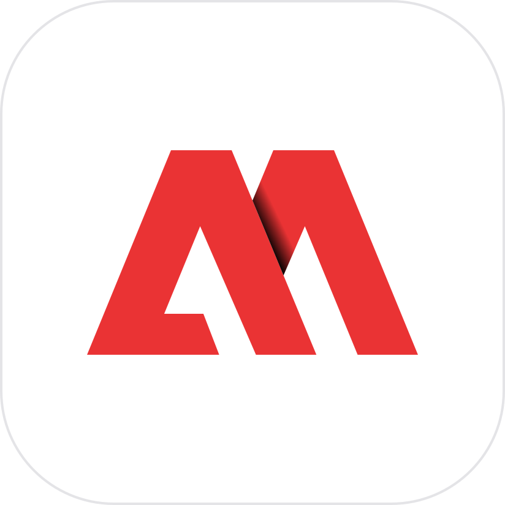

<p align="center">
  
</p>

<h1 align="center">MANUCRAFT</h1>

<p align="center">
  <b>One place to install, update and open the MANUCRAFT builds of the Craft apps.</b><br>
  PhotoCraft, VectorCraft, FilmCraft, LightCraft, PdfCraft, EffectCraft, DesignCraft, WordCraft,<br>
  DeckCraft, GridCraft, CADCraft, SoundCraft and FigCraft, from <code>github.com/netoonine/&lt;app&gt;</code>.
</p>

MANUCRAFT is based on ArtCraft Launcher by the ArtCraft team; not affiliated with or endorsed by them.

<!-- MANUCRAFT: this README is the fork's own. On an upstream sync, keep ours (git checkout --ours README.md). -->

## What it does

MANUCRAFT is a small native app (Rust, egui; no Electron, no web view) that lists the thirteen
Craft apps, shows which ones are installed and in which version, installs the right build for the
computer and says when an update is out. It can sit in the menu bar.

- **Where the apps come from:** the latest GitHub Release of each fork, `github.com/netoonine/<app>`.
  The launcher updates itself from `github.com/netoonine/craft-launcher`.
- **What it checks:** every download against the release's `SHA256SUMS.txt` (or GitHub's own
  digest); on macOS, that the app inside the DMG is the app it should be (bundle id
  `ai.storyteller.<app>`, the release's version) and that its code signature is intact
  (`codesign --verify --deep --strict`; ad-hoc signatures are accepted).
- **What it never does:** talk to ArtCraft's servers. The upstream release feed
  (`api.storyteller.ai`) is switched off; only GitHub is asked. The one other download is the
  pictures on each app's details page, read from `raw.githubusercontent.com/storytold/craft-launcher-assets`.

macOS on Apple silicon is the platform this fork builds and tests; the code still compiles for
Windows, Linux, FreeBSD and the web.

## Install

Download `artcraft-launcher-<version>-macos-aarch64.dmg` from the
[latest release](https://github.com/netoonine/craft-launcher/releases/latest), open it and drag
**MANUCRAFT** to Applications. The builds are ad-hoc signed (no Apple Developer account), so the
first time macOS may refuse to open it: right-click → Open, or
`xattr -dr com.apple.quarantine /Applications/MANUCRAFT.app`.

MANUCRAFT keeps its install records and log in `~/Library/Application Support/MANUCRAFT`, its
downloads and saved answers in `~/Library/Caches/MANUCRAFT`, its settings in
`~/Library/Application Support/ai.manucraft.launcher/app.ron`, and answers on `127.0.0.1:47431` so a second start brings the
running one forward. It can run side by side with the official ArtCraft Launcher.

## Publishing releases

The naming and versioning contract for the apps' releases and for the launcher's own is in
[`MANUCRAFT.md`](MANUCRAFT.md#3-releases-e-versionamento). In short: tag `v<upstream version>+m<N>`
(for example `v0.9.0+m2`), not a pre-release, with the app's DMG and a `SHA256SUMS.txt`.

## Build from source

```sh
export PATH="/opt/homebrew/opt/rustup/bin:$PATH"
cargo run --release -p artcraft-launcher          # the desktop app
cargo test --workspace                            # tests
cargo clippy --workspace --all-targets -- -D warnings
packaging/macos/package.sh --arch aarch64         # MANUCRAFT.app + DMG (ad-hoc signed)
```

Contributors and AI agents: read [`MANUCRAFT.md`](MANUCRAFT.md), then [`AGENTS.md`](AGENTS.md).

## License and credits

MANUCRAFT keeps ArtCraft Launcher's license: [MIT](LICENSE-MIT) or [Apache-2.0](LICENSE-APACHE),
at your option. Copyright (c) 2026 ArtCraft Team and the ArtCraft Launcher contributors; required
notices are in [NOTICE](NOTICE).

The ArtCraft name, logo and "A" mark are trademarks of the ArtCraft Team and are not part of this
fork: the MANUCRAFT mark and wordmark (`assets/manucraft/`) are original. Bundled fonts and icons
keep their own open licenses, listed in [ATTRIBUTION.md](ATTRIBUTION.md). The Craft apps' icons
(`assets/app-icons/`) are each app's own, MIT OR Apache-2.0.
